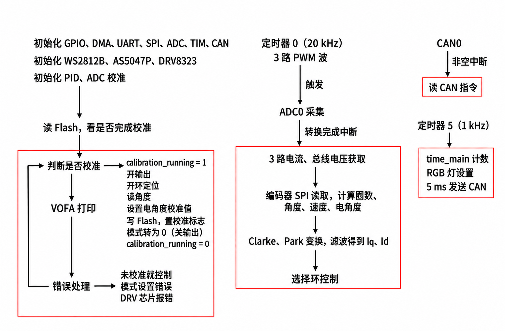

# MyFOC

基于 GD32F303、DRV8323 和 AS5047P 的三相电机 FOC 控制固件，用于轮足机器人的腿电机与轮电机控制。

一块驱动板控制一个电机。通过编译配置区分左腿、左轮、右腿、右轮，四块板可共用一条 CAN 总线。

当前实现：

- 电流模式：Iq 电流闭环，Id 目标为 0。
- 速度模式：速度环、电流环串级控制。
- 位置模式：位置环、速度环、电流环串级控制。
- 电角度零偏校准及 Flash 保存。
- 串口目标设置、PID 参数调整和数据输出。
- CAN 四电机独立控制，四电机位置、速度、电流及状态主动反馈。

本文对应当前源码中的协议：位置rad、速度rad/s、电流A。CAN下发为小端uint32模式＋float32目标；每个电机每5 ms反馈电流/速度和位置/状态两帧。

## 1. 硬件与开发环境

| 项目 | 当前工程配置 |
|---|---|
| MCU | GD32F303CCT6，Cortex-M4 |
| 系统时钟 | 120 MHz |
| 栅极驱动 | DRV8323，SPI 配置，3PWM 模式 |
| 角度编码器 | AS5047P，SPI 读取14位单圈角度 |
| 电流采样 | 12位 ADC，两路相电流采样，第三相由 `Ic = -Ia - Ib` 重构 |
| 采样换算 | 5 mΩ 采样电阻、40倍增益、3.3 V ADC 参考值 |
| 母线电压 | 约24 V调试，程序使用 ADC 采样更新母线电压 |

GPIO 配置如下，实际接线应结合驱动板原理图：

| 接口 | MCU 引脚 |
|---|---|
| CAN0 TX / RX | PA12 / PA11 |
| USART2 TX / RX | PB10 / PB11 |
| 编码器 SPI0 SCK / MISO / MOSI / CS | PB3 / PB4 / PB5 / PA15 |
| DRV8323 SPI1 SCK / MISO / MOSI / CS | PB13 / PB14 / PB15 / PB12 |
| DRV8323 EN / nFAULT | PB7 / PB2 |
| 三相 PWM A / B / C | PA10 / PA9 / PA8 |
| 母线电压 / Ia / Ib 采样 | PA0 / PA3 / PA2 |

## 2. 工程目录

```text
MyFOC/
├── User/
│   ├── main.c              初始化、串口指令解析、CAN指令解析/数据反馈
│   └── Mydef.h             电机ID、方向、极对数、减速比和周期配置
├── CODE/
│   ├── APP/                控制环、FOC变换、定时任务、VOFA
│   ├── Algorithm/          PID、滤波及数学函数
│   ├── BSP/                ADC、PWM、CAN、串口、SPI、Flash等外设
│   └── Driver/             AS5047P、DRV8323、WS2812B驱动
├── Libraries/              CMSIS及GD32外设库
├── project.uvprojx         Keil工程入口
├── LICENSE
└── README.md
```

## 3. 电机配置

```c
#define MOTOR_LEG_WHEEL 0   // 0：腿，1：轮
#define MOTOR_LEFT_RIGHT 0  // 0：左，1：右
```

四种配置与 CAN ID 的对应关系：

| 电机 | LEG_WHEEL | LEFT_RIGHT | 接收控制ID | 电流/速度反馈ID | 位置/状态反馈ID |
|---|---:|---:|---|---|---|
| 左腿 | 0 | 0 | 0x101 | 0x201 | 0x211 |
| 左轮 | 1 | 0 | 0x102 | 0x202 | 0x212 |
| 右腿 | 0 | 1 | 0x103 | 0x203 | 0x213 |
| 右轮 | 1 | 1 | 0x104 | 0x204 | 0x214 |

每块板使用独立控制ID，接收完整8字节指令。四块板应分别配置、编译和下载。

当前电机参数：

| 电机 | 型号 | 极对数 PP | 减速比 G | DIR |
|---|---|---:|---:|---:|
| 左腿 / 右腿 | GIM6010-8 | 14 | 8 | -1 |
| 左轮 | M0603A_111 | 10 | 1 | 1 |
| 右轮 | M0603A_111 | 10 | 1 | -1 |

更换电机、编码器安装方式或减速机构后，应核对 `PP`、`G`、`DIR`、PID 和腿限位，并重新校准。

## 4. 程序结构



控制主路径：

```text
TIMER0_CH3触发ADC
    → ADC转换完成中断
    → 电流换算、编码器角度/速度更新
    → 电角度计算、Clarke/Park变换及滤波
    → 根据模式执行电流/速度/位置控制
    → SVPWM更新三相占空比

TIMER5中断 → 每1ms控制RGB灯、每5ms提交两帧CAN反馈

CAN0FIFO非空中断 → 读取CAN指令解析

主循环 → 校准任务、VOFA打印数据、错误处理
```

## 5. 腿电机的限幅

腿电机对外位置：**0为收腿，数值增加表示伸腿，范围约0～0.56199602 rad（32.2°）**。

内部限位来自 `User/Mydef.h`，属于当前机构的标定值：
| 电机 | 收腿端位置 rad | 伸腿端位置 rad |
|---|---:|---:|
| 左腿 | -0.16388642 | -0.72588244 |
| 右腿 | -0.61749749 | -0.05550147 |


## 6. 首次运行与校准

1. 完成角色配置和固件下载，上电等待电流零偏采样结束，串口输出 `Init Over`。
2. 检查角度、速度及电流反馈。若未保存过有效校准数据，先执行一次模式4。
3. 校准期间产生定位力矩，程序计算电角度零偏并写入 Flash，然后返回停止模式。
4. 判断反馈的校准标志位，再下发运行目标。

校准数据读取、保存实现位于 `CODE/BSP/Flash.c`；当前地址为 `0x0803FC00`，使用魔数判断记录是否存在。调整芯片容量或链接布局时，应同步核对该地址及擦除页范围。

## 7. 串口协议

串口为 **USART2，115200，8N1**。命令使用文本，**以换行符 `\n` 结束**。

| 命令 | 含义 |
|---|---|
| `m0` | 停止输出 |
| `m1` | 电流模式 |
| `m2` | 速度模式 |
| `m3` | 位置模式 |
| `m4` | 执行一次校准 |
| `c1.0` | 设置电流目标1 A |
| `v1.0` | 设置速度目标1 rad/s |
| `p0.1` | 设置位置目标0.1 rad |

PID参数可通过串口修改，命令后直接跟数值：

| 控制环 | Kp | Ki | Kd |
|---|---|---|---|
| 位置 | kpp | kip | kdp |
| 速度 | kpv | kiv | kdv |
| Iq | kpq | kiq | kdq |
| Id | kpd | kid | kdd |

## 8. CAN下发协议

经典CAN，1 Mbps，11位标准数据帧，DLC=8；左腿/左轮/右腿/右轮控制ID依次为0x101～0x104，控制周期5 ms。

| 字节（从0编号） | 内容 |
|---|---|
| 0～3 | 模式，uint32，小端 |
| 4～7 | 目标，IEEE 754 float32，小端|

模式0停止、1电流、2速度、3位置、4单次校准。目标单位为A、rad/s、rad。停止和校准的数据填0。

| 操作（ID选择目标电机） | 8字节CAN数据 |
|---|---|
| 速度＋10 rad/s | `02 00 00 00 00 00 20 41` |
| 速度－10 rad/s | `02 00 00 00 00 00 20 C1` |
| 位置0.5 rad | `03 00 00 00 00 00 00 3F` |
| 单次校准 | `04 00 00 00 00 00 00 00` |
| 停止 | `00 00 00 00 00 00 00 00` |

## 9. CAN反馈协议

每块板每5 ms主动提交两帧，所有float字段均为小端IEEE 754单精度。

**使用经典CAN、1 Mbps、11位标准数据帧，DLC=8**

| 电机 | 第一帧 | 第二帧 |
|---|---|---|
| 左腿 | 0x201 | 0x211 |
| 左轮 | 0x202 | 0x212 |
| 右腿 | 0x203 | 0x213 |
| 右轮 | 0x204 | 0x214 |

第一帧：

| 字节 | 内容 | 类型 / 单位 |
|---|---|---|
| 0～3 | 实际Iq | float / A |
| 4～7 | 实际速度 | float / rad/s |

第二帧：

| 字节 | 内容 | 类型 |
|---|---|---|
| 0～3 | 实际位置 | float / rad |
| 4 | 当前模式 | uint8_t；0～4同控制模式，0xFF为故障 |
| 5 | 错误码 | uint8_t |
| 6（第7字节） | 校准标志 | bit0正在校准，bit1已校准，其余位为0 |
| 7（第8字节） | 在线心跳标记 | 固定为1 |

主控收到有效状态帧时更新对应电机的接收时间，超时则判离线，不能仅保留上次收到的在线标记。

四电机5 ms周期通信：每周期4帧控制＋8帧反馈；1 Mbps下理论占用率26.64%（不计位填充），计入位填充的保守上界为32.4%，均不含错误重传。

错误码：

| 数值 | 含义 |
|---|---|
| 0 | 无错误 |
| 1 | 未校准 |
| 2 | DRV8323驱动错误 |
| 3 | 模式设置错误 |


